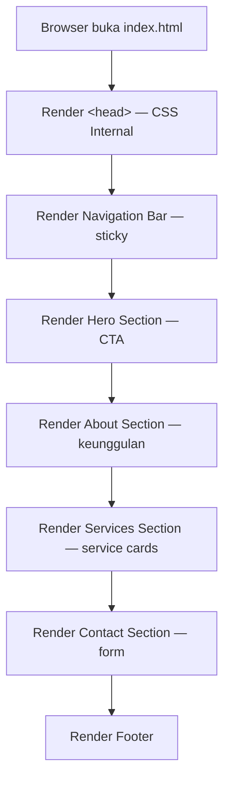
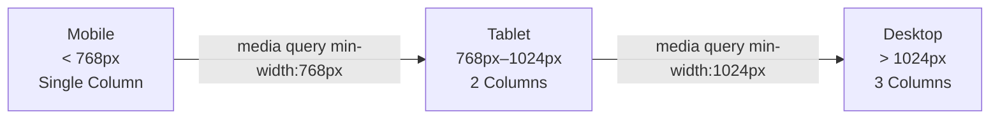

# Design Document

## Company Profile Landing Page

---

## Overview

Fitur ini adalah sebuah **Company Profile Landing Page** berbasis HTML5 murni — satu file HTML tunggal (`index.html`) dengan CSS internal dan tanpa ketergantungan pada framework eksternal. Halaman dirancang dengan pendekatan *single-page* yang menampilkan semua informasi perusahaan secara vertikal: Navigation Bar, Hero Section, About Section, Services Section, Contact Section, dan Footer.

Tujuan utama dokumen desain ini adalah mendefinisikan struktur, komponen, gaya visual, dan strategi pengujian sehingga implementasi menghasilkan halaman yang semantis, responsif, dan mudah di-deploy hanya dengan membuka satu file di browser.

**Keputusan desain utama:**

- **Single-file HTML5** — semua CSS ditulis di dalam tag `<style>` di `<head>`, tidak ada file eksternal.
- **Tanpa JavaScript framework** — interaksi (smooth scroll, form validation) menggunakan HTML5 native + CSS saja.
- **Mobile-first CSS** — media queries diterapkan dari lebar terkecil ke terbesar.
- **Warna primer & sekunder konsisten** — dua warna utama mendefinisikan keseluruhan palet.

---

## Architecture

Karena ini adalah halaman statis tanpa back-end, arsitekturnya sangat sederhana:

```
index.html
├── <head>
│   ├── Meta tags (charset, viewport, title)
│   └── <style> — semua CSS internal
└── <body>
    ├── <header> / <nav>  ← Navigation Bar (sticky)
    ├── <main>
    │   ├── <section id="hero">     ← Hero Section
    │   ├── <section id="about">    ← About Section
    │   ├── <section id="services"> ← Services Section
    │   └── <section id="contact">  ← Contact Section
    └── <footer>                    ← Footer
```

Tidak ada server-side rendering, database, atau API. Formulir kontak menggunakan `action="mailto:..."` atau JavaScript minimal untuk pesan konfirmasi inline. Browser modern memproses semua logika secara lokal.

---

## Components and Interfaces

### 1. Navigation Bar (`<header>` + `<nav>`)

- **Posisi:** `position: sticky; top: 0;` agar selalu terlihat saat scroll.
- **Konten:**
  - Kiri: nama/logo perusahaan (teks atau `` dengan alt text).
  - Kanan: tautan `<a href="#about">`, `<a href="#services">`, `<a href="#contact">`.
- **Smooth scroll:** diimplementasikan dengan CSS `scroll-behavior: smooth` pada elemen `<html>`.
- **Kontras:** latar belakang gelap/warna primer dengan teks terang.
- **Aksesibilitas:** elemen `<nav>` dengan `aria-label="Main navigation"`.

### 2. Hero Section (`<section id="hero">`)

- **Layout:** flexbox kolom, terpusat secara horizontal dan vertikal.
- **Konten:**
  - `<h1>` — headline utama (satu kalimat).
  - `<p>` — sub-headline (maksimal dua kalimat).
  - `<a href="#contact" class="btn-cta">` — CTA button.
- **Visual:** latar belakang dengan warna primer atau gradient. Teks putih/terang.
- **Ukuran:** minimal `min-height: 100vh` agar mengisi penuh viewport pertama.

### 3. About Section (`<section id="about">`)

- **Konten:**
  - Judul seksi: `<h2>About Us</h2>` atau `<h2>Tentang Kami</h2>`.
  - Dua paragraf deskripsi perusahaan.
  - Grid tiga kartu keunggulan (ikon + judul + teks singkat).
- **Layout kartu keunggulan:** CSS Grid, `repeat(auto-fit, minmax(200px, 1fr))`.
- **Visual:** latar belakang berbeda dari Hero Section (misalnya putih atau abu-abu terang).

### 4. Services Section (`<section id="services">`)

- **Konten:**
  - Judul seksi: `<h2>Our Services</h2>` atau `<h2>Layanan Kami</h2>`.
  - Minimal tiga service cards, masing-masing berisi: judul layanan (`<h3>`) + deskripsi singkat (`<p>`).
- **Layout:** CSS Grid, `repeat(auto-fit, minmax(250px, 1fr))`, responsif 1–3 kolom.
- **Hover effect:** `transform: translateY(-4px)` + `box-shadow` pada `:hover` dengan `transition`.

### 5. Contact Section (`<section id="contact">`)

- **Konten:**
  - Judul seksi: `<h2>Contact Us</h2>` atau `<h2>Hubungi Kami</h2>`.
  - Info kontak: email (`<a href="mailto:...">`) dan nomor telepon (`<a href="tel:...">`).
  - Formulir: field `name` (required), `email` (required, type="email"), `message` (required, `<textarea>`), tombol submit.
- **Validasi:** HTML5 native (`required`, `type="email"`) — tidak perlu JavaScript tambahan.
- **Submit behavior:** `action="mailto:info@perusahaan.com" method="POST"` atau handler JavaScript inline untuk pesan konfirmasi.
- **Aksesibilitas:** setiap input memiliki `<label>` yang terhubung via `for`/`id`.

### 6. Footer (`<footer>`)

- **Konten:**
  - Nama perusahaan.
  - Teks copyright: `© 2025 [Nama Perusahaan]. All rights reserved.`
- **Visual:** latar belakang gelap, teks terang, padding cukup.

---

## Data Models

Halaman ini adalah statis murni — tidak ada model data dinamis, database, atau state management. Semua "data" adalah konten HTML yang di-hardcode. Berikut representasi konseptual konten yang perlu diisi:

### Company Info (hardcoded ke HTML)

| Field | Tipe | Contoh |
|---|---|---|
| `company_name` | string | "Innovate Corp" |
| `headline` | string | "Kami Membangun Solusi Digital Masa Depan" |
| `sub_headline` | string | "Tim kami berdedikasi menghadirkan teknologi terbaik..." |
| `email` | string | "info@innovatecorp.com" |
| `phone` | string | "+62 812-3456-7890" |
| `copyright_year` | number | 2025 |

### Service Card (diulang ≥3 kali)

| Field | Tipe | Contoh |
|---|---|---|
| `title` | string | "Web Development" |
| `description` | string | "Kami membangun website responsif..." |
| `icon` | string (emoji/SVG) | "💻" |

### About Feature (diulang ≥3 kali)

| Field | Tipe | Contoh |
|---|---|---|
| `title` | string | "Pengalaman 10 Tahun" |
| `description` | string | "Kami telah melayani ratusan klien..." |
| `icon` | string (emoji/SVG) | "🏆" |

### Contact Form Fields

| Field | HTML Type | Validasi |
|---|---|---|
| `name` | text | required |
| `email` | email | required, format email |
| `message` | textarea | required |

---

## Design Tokens (Palet Warna & Tipografi)

Definisi token desain menggunakan CSS custom properties untuk konsistensi:

```css
:root {
  /* Warna */
  --color-primary: #2563EB;      /* Biru primer — navigasi, CTA, aksen */
  --color-secondary: #F59E0B;    /* Kuning sekunder — hover, highlight */
  --color-dark: #1E293B;         /* Teks gelap, footer background */
  --color-light: #F8FAFC;        /* Latar belakang terang */
  --color-white: #FFFFFF;
  --color-text: #334155;         /* Body text */
  --color-text-muted: #64748B;   /* Teks sekunder */

  /* Tipografi */
  --font-family: 'Segoe UI', system-ui, -apple-system, sans-serif;
  --font-size-base: 16px;        /* Minimum body text */
  --font-size-h1: clamp(2rem, 5vw, 3.5rem);
  --font-size-h2: clamp(1.5rem, 3vw, 2.25rem);
  --font-size-h3: 1.25rem;

  /* Spacing */
  --section-padding: 5rem 1.5rem;
  --container-max-width: 1100px;

  /* Efek */
  --border-radius: 0.5rem;
  --box-shadow: 0 4px 6px -1px rgba(0,0,0,0.1), 0 2px 4px -1px rgba(0,0,0,0.06);
  --transition: 0.25s ease;
}
```

---

## Mermaid Diagram: Layout Halaman



---

## Mermaid Diagram: Responsive Breakpoints



---

## Error Handling

Karena halaman ini adalah static HTML tanpa server-side logic, "error handling" terbatas pada:

### Validasi Formulir Kontak
- **HTML5 native validation** (`required`, `type="email"`) menampilkan pesan error browser-default secara otomatis jika field kosong atau format email salah.
- Tidak diperlukan JavaScript tambahan untuk validasi dasar.
- Jika diinginkan pesan konfirmasi setelah submit, dapat menggunakan atribut `onsubmit` minimal atau `action="mailto:"` dengan `enctype="text/plain"`.

### Gambar/Ikon Tidak Tersedia
- Semua ikon menggunakan emoji Unicode atau inline SVG — tidak ada request network untuk ikon.
- Jika menggunakan ``, wajib menyertakan atribut `alt` yang deskriptif sebagai fallback.

### Browser Tidak Mendukung Fitur Modern
- CSS yang digunakan (`flexbox`, `grid`, `custom properties`, `sticky`) didukung oleh semua browser modern (Chrome 88+, Firefox 78+, Safari 14+, Edge 88+).
- Tidak ada polyfill diperlukan.
- Smooth scroll (`scroll-behavior: smooth`) diterapkan di CSS — jika tidak didukung, scroll tetap berfungsi secara normal (langsung lompat ke seksi).

### Form Submit Tanpa Server
- Formulir menggunakan `mailto:` — perilaku tergantung konfigurasi email client pengguna.
- Jika email client tidak tersedia, browser akan menampilkan dialog atau tidak merespons — ini adalah keterbatasan yang diterima dari implementasi pure HTML.

---

## Testing Strategy

Fitur ini adalah **UI rendering statis** (single HTML file, CSS internal, tanpa logika transformasi data). Property-based testing tidak sesuai untuk kasus ini karena:
- Tidak ada pure function dengan input/output yang bervariasi secara bermakna.
- Konten bersifat hardcoded — tidak ada logika yang perlu diverifikasi lintas banyak input.
- Yang perlu diverifikasi adalah struktur HTML, visual rendering, dan perilaku interaksi spesifik.

Strategi pengujian yang digunakan:

### 1. Structural / Example-Based Tests (HTML Validation)

Validasi bahwa dokumen HTML memenuhi standar dan requirements struktural:

| Test | Kriteria | Tool |
|---|---|---|
| HTML valid | Tidak ada error pada W3C Markup Validator | [validator.w3.org](https://validator.w3.org) |
| Semantic elements ada | `<header>`, `<nav>`, `<main>`, `<section>`, `<footer>` hadir | DOM inspection |
| Meta tags benar | `charset=UTF-8`, `viewport` hadir | DOM inspection |
| `id` anchor benar | `#hero`, `#about`, `#services`, `#contact` ada | DOM inspection |
| Form fields ada | `name`, `email`, `message` dengan `required` | DOM inspection |
| Minimum 3 service cards | Setidaknya 3 `.service-card` elemen | DOM count |
| Minimum 3 about features | Setidaknya 3 `.feature-card` elemen | DOM count |

### 2. Visual Regression Tests (Manual / Snapshot)

Verifikasi visual dengan screenshot pada berbagai ukuran viewport:

| Breakpoint | Lebar | Yang Diverifikasi |
|---|---|---|
| Mobile | 375px | Single-column layout, nav menampilkan semua tautan |
| Tablet | 768px | 2-column cards, tata letak transisi |
| Desktop | 1280px | 3-column service cards, layout penuh |

Tools yang disarankan: screenshot manual di browser DevTools, atau [Playwright](https://playwright.dev) untuk otomasi snapshot.

### 3. Interaction / Behavior Tests (Manual)

| Skenario | Langkah | Expected Result |
|---|---|---|
| Smooth scroll | Klik tautan nav "About" | Halaman scroll mulus ke `#about` |
| Sticky nav | Scroll ke bawah halaman | Navigation Bar tetap terlihat di atas |
| Hover service card | Arahkan kursor ke card | Card naik sedikit + shadow muncul |
| Form validation | Submit form kosong | Browser menampilkan pesan validasi native |
| Form email validation | Masukkan email tidak valid | Browser menampilkan pesan format email |
| CTA button | Klik CTA di Hero | Scroll ke Contact Section |

### 4. Accessibility Checks (Manual)

| Check | Metode |
|---|---|
| Keyboard navigation | Tab melalui semua link dan form fields |
| Screen reader | Nav `aria-label`, semua `` punya `alt` |
| Color contrast | WCAG AA minimum 4.5:1 untuk body text |
| Focus indicators | Elemen fokus terlihat jelas |

> **Catatan:** Validasi aksesibilitas penuh memerlukan pengujian manual dengan teknologi asistif dan review oleh pakar aksesibilitas.

### 5. Cross-Browser Compatibility

Uji rendering manual di:
- Chrome (latest)
- Firefox (latest)
- Safari (latest)
- Edge (latest)

Tidak diperlukan plugin atau polyfill tambahan.
